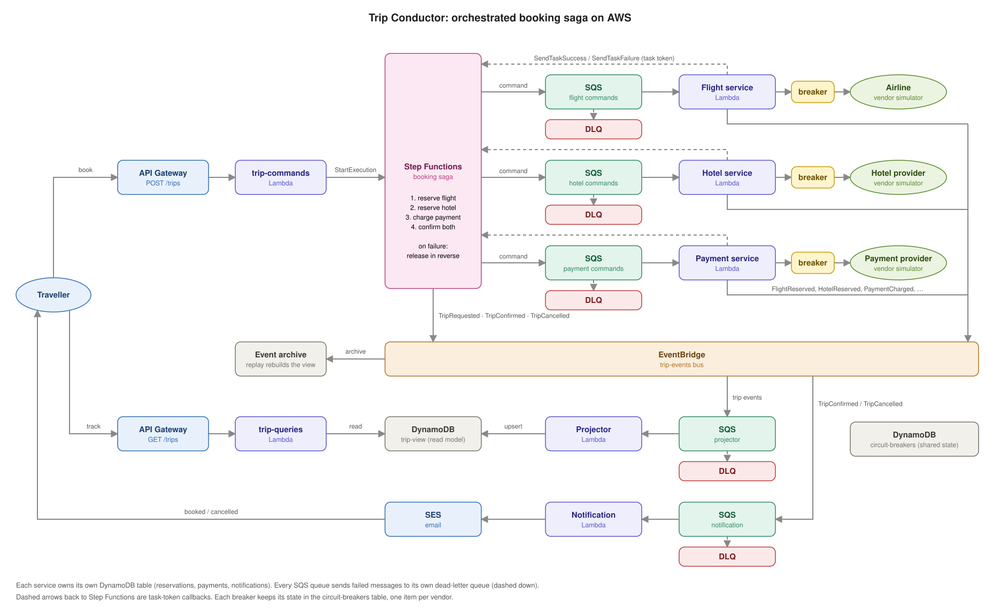
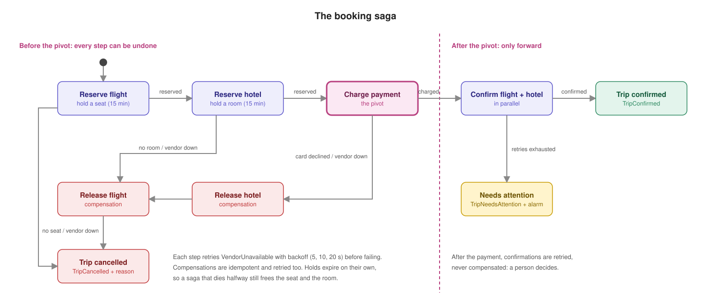
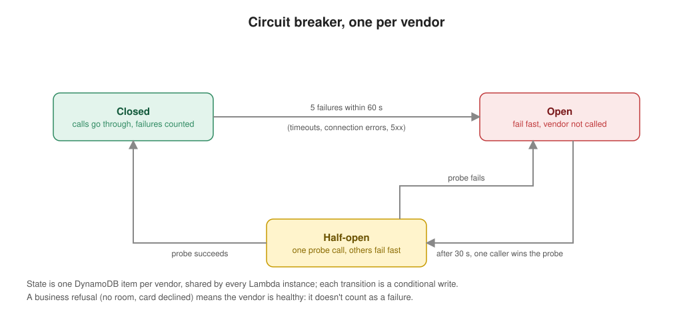

# Trip Conductor

I wanted to practise **orchestration**: one component coordinating several services through a business transaction that must succeed as a whole, or not at all. To have something concrete to build, I imagined a scenario, split it into the problems it raises, matched each problem with a design pattern, and then looked for the AWS services to build each pattern with.

> **Status:** the booking transaction works end to end: the saga reserves a flight and a hotel, charges the payment, then confirms both, and releases in reverse when a step before the payment fails. Bookings are started from the Step Functions console for now; the API, the read model and the notifications come next.

| Part | State |
|---|---|
| [Requirements](docs/requirements.md), [command and event catalog](docs/events/catalog.md), [decisions](docs/decisions/) | written |
| [Terraform stacks and CI/CD](infra/README.md) (OIDC, plan on pull requests, deploy on `main`) | built |
| Booking saga ([`statemachine/`](statemachine/)): reserve, charge, confirm, compensate, `NeedsAttention` | built |
| [Flight](services/flight/), [hotel](services/hotel/) and [payment](services/payment/) services, each behind a [circuit breaker](libs/circuit_breaker/) | built |
| [Vendor simulator](services/vendor_simulator/) with chaos settings per vendor and operation | built |
| `POST /trips` (trip-commands) | next |
| Projector, `trip-view` and `GET /trips` (CQRS) | planned |
| Notifications, `CircuitOpened` alarm, read model rebuild | planned |

To try it, follow [Try it](infra/README.md#try-it).

## The scenario

A traveller books a weekend in Lisbon on a travel website: a flight, a hotel, one payment. Behind the "Book" button, the website talks to three outside systems it doesn't control: an airline, a hotel provider and a payment provider.

1. **The traveller clicks "Book".** The connection is slow, so they click again.
2. **The website holds a seat** on the flight with the airline.
3. **It holds a room** with the hotel provider. Sometimes the last room just went, and the seat held a second ago must be given back.
4. **It charges the card.** Sometimes the card is declined, and both the room and the seat must be given back.
5. **It confirms the seat and the room.** The money is taken now, so a hiccup at the hotel provider can't be an excuse to cancel. The website keeps trying, and calls a person if it really can't.
6. **One evening the airline's system goes down.** Every booking waits for a timeout, fails, and retries, which makes things worse for the airline while it tries to recover.
7. **Meanwhile the traveller refreshes "My trips"** to see where the booking is, and so do thousands of others.
8. **At the end, they get an email**: booked, or cancelled with the reason.

## One pattern per problem

| Step | The problem | Design pattern | Built with on AWS |
|---|---|---|---|
| 2–5 | Several services must succeed together, and nobody shares a database transaction | **Saga, orchestrated**: local steps, each with a compensating action, driven by one coordinator | Step Functions Standard workflow (`Catch` → compensation chain) |
| 3–4 | Undo what's already done, in reverse order | **Compensating transaction** | One "release" command per step, retried until it succeeds |
| 5 | After the payment, undoing is worse than retrying | **Pivot transaction + forward recovery** | Step Functions `Retry`, then a `NeedsAttention` state + CloudWatch alarm |
| 2–5 | The coordinator must hand work to services that may be slow or down, without losing it | **Asynchronous request-reply** | SQS queue per service + Step Functions task tokens (`.waitForTaskToken`) |
| 2–3 | If the saga dies halfway, holds must not stay forever | **Reservation with expiry** (a semantic lock) | Holds with a 15 min expiry, DynamoDB TTL |
| 6 | Stop hammering a system that is down | **Circuit breaker** | Breaker state shared by all Lambdas in DynamoDB, conditional writes |
| 6 | Retrying too fast makes outages worse | **Retry with exponential backoff** | Step Functions `Retry` (5, 10, 20 s) |
| 1 | A double click must not book twice | **Idempotent receiver** | Trip ID from customer + `Idempotency-Key`, used as the execution name |
| 7 | Reads must not load the booking flow, and need data from every service | **CQRS** | Projector Lambda → `trip-view` DynamoDB table → separate query API |
| 7 | The read model must be rebuildable | **Event replay** | EventBridge archive + replay |
| 8 | Reactions to the outcome shouldn't be part of the transaction | **Publish-subscribe** (choreography for side effects) | EventBridge rules → SQS → notification Lambda → SES |

The orchestrator drives the transaction; events only carry what *happened* to whoever is interested. The rest of this README goes through how these pieces fit together.

## Orchestration vs choreography

| | Apply Relay (choreography) | Trip Conductor (orchestration) |
|---|---|---|
| Who knows the flow | Nobody: it emerges from subscriptions | The state machine, in one file |
| Adding a step | New subscriber, no change to others | Change the state machine |
| Undoing work on failure | Each service must listen for failure events | The orchestrator runs compensations in reverse order |
| "Where is trip X stuck?" | Reconstruct from logs and the audit log | Open the execution in the Step Functions console |
| Coupling | Services know event shapes | Services know command shapes; the orchestrator knows everyone |

Trip Conductor still uses events, just not to drive the transaction: domain events feed the read model (CQRS) and side effects like notifications. Orchestration for the transaction, choreography for the reactions. More in [ADR 0001](docs/decisions/0001-orchestration-over-choreography.md).

## Architecture



Every queue has a dead-letter queue and an alarm. The diagrams are drawn by `docs/diagrams/draw.py`: edit the layout there and rerun it.

## The booking saga



| # | Step | Service | Compensation | Kind |
|---|---|---|---|---|
| 1 | Reserve flight (seat hold, 15 min) | flight | Release flight | compensatable |
| 2 | Reserve hotel (room hold, 15 min) | hotel | Release hotel | compensatable |
| 3 | Charge payment (sum of both holds) | payment | none needed: if it fails, nothing was charged | **pivot** |
| 4 | Confirm flight + hotel (in parallel) | flight, hotel | none: retried until it succeeds | retriable |

Two saga ideas are worth calling out:

* **The pivot.** Before the payment, every step can be undone. After it, the saga only moves forward: confirmations are retried, never compensated, because refunding a customer whose booking is one retry away from succeeding is the worse outcome. If confirmations still fail after the retry budget, the trip goes to `NeedsAttention` and an alarm fires: a person decides. The same happens if the charge itself never gets an answer: the card may have been charged, so nothing is released before a person checks.
* **Holds instead of bookings.** Steps 1 and 2 place *holds* that expire on their own. If the whole saga died mid-flight, the inventory frees itself; compensation is the fast path, expiry is the safety net.

Compensations are steps too: idempotent, retried, and if they still fail, they alarm instead of being silently dropped.

## Circuit breaker

The vendor simulator stands in for an airline, a hotel provider and a payment provider, and can be told to fail or slow down (`scripts/chaos.py airline --failure-rate 1`). Each service calls its vendor through a circuit breaker whose state lives in DynamoDB.



* **Why DynamoDB and not memory:** a Lambda function runs as many concurrent instances. An in-memory breaker in each one would only see its own failures, so the vendor would keep getting hammered by the others. A shared record lets one instance's failures protect all of them.
* **What counts as a failure:** timeouts, 5xx and connection errors. A business "no" (room unavailable, card declined) means the vendor is healthy and doesn't count.
* **Open means fail fast:** the service returns `VendorUnavailable` to the saga without calling the vendor. The state machine retries that error with backoff (5 s, 10 s, 20 s); if the vendor is still down, it compensates and cancels with a clear reason instead of waiting forever.
* Opening and closing the breaker publishes `CircuitOpened` / `CircuitClosed`. An alarm on `CircuitOpened` is planned.

More in [ADR 0005](docs/decisions/0005-circuit-breaker-in-dynamodb.md).

## CQRS

* **Command side:** `POST /trips` validates the request and starts a saga execution, then answers `202 Accepted` with `Location: /trips/{trip_id}`. There is no write-side "trips" table: the saga's execution plus each service's own reservation table *are* the write model.
* **Query side:** a projector consumes every trip event from EventBridge (not `CircuitOpened` / `CircuitClosed`, which are about a vendor) and maintains `trip-view`, a table shaped for the screens: status, per-leg status, a timeline. `GET /trips/{id}` and `GET /trips?customer_id=` read only from it.
* **Rebuildable:** every event on the bus is archived. `scripts/rebuild_read_model.py` empties the view and replays the archive to the projector's rule only, so a rebuild can't resend emails. The projector must be idempotent and tolerate events arriving out of order.
* **The price:** right after `POST`, `GET` can return `404` for a moment. The client polls. More in [ADR 0006](docs/decisions/0006-cqrs-read-model.md).

## Services

| Service | Triggered by | Talks to | Publishes | Owns |
|---|---|---|---|---|
| trip-commands | `POST /trips` | Step Functions | nothing (the saga publishes `TripRequested`) | nothing |
| booking saga | `StartExecution` | flight, hotel, payment queues | `TripRequested`, `TripConfirmed`, `TripCancelled`, `TripNeedsAttention` | execution state |
| flight | `ReserveFlight`, `ConfirmFlight`, `ReleaseFlight` | airline (via breaker) | `FlightReserved`, `FlightConfirmed`, `FlightReleased` | `flight-reservations` table |
| hotel | `ReserveHotel`, `ConfirmHotel`, `ReleaseHotel` | hotel provider (via breaker) | `HotelReserved`, `HotelConfirmed`, `HotelReleased` | `hotel-reservations` table |
| payment | `ChargePayment` | payment provider (via breaker) | `PaymentCharged`, `PaymentDeclined` | `payments` table |
| projector | all domain events except `CircuitOpened` / `CircuitClosed` | nothing | nothing | `trip-view` table |
| trip-queries | `GET /trips…` | nothing | nothing | reads `trip-view` |
| notification | `TripConfirmed`, `TripCancelled` | SES | nothing | `notifications` table, `customer-contacts` table (stands in for a customer service) |
| vendor-simulator | HTTP from services | nothing | nothing | chaos settings (SSM) |

## Reliability

| Risk | How it's handled |
|---|---|
| Client retries `POST /trips` | Clients send an `Idempotency-Key`. The trip ID is derived from customer + key and used as the execution name, so Step Functions refuses a second execution and the API returns the first one. |
| A command is delivered twice | Each service writes its reservation with a conditional write keyed on the trip ID; a repeat returns the stored result instead of calling the vendor again. Only final results are stored, so a retry after `VendorUnavailable` really tries the vendor again. |
| A service is down | Its command waits in its SQS queue. The saga task has a timeout, so a service that never answers fails the step and triggers compensation instead of hanging. |
| A vendor is down | Circuit breaker fails fast; the saga retries with backoff, then compensates. |
| A compensation fails | Retried with backoff; if it still fails, the execution ends in a failed state and an alarm fires. Holds expire on their own as the last safety net. |
| Confirmation fails after payment | Forward recovery: retried, then `NeedsAttention` + alarm. No automatic refund. |
| The charge gets no answer | Retried: the trip ID is the provider's idempotency key, so a retry can't charge twice. Still no answer: `NeedsAttention`, holds kept, a person checks. |
| A hold expires before it's confirmed | The hold lifetime (15 min) is longer than the saga's worst case to reach confirmation, all retries included. A test on the state machine definition checks this budget. |
| Events arrive out of order at the projector | Per-leg updates are independent, terminal statuses win, and every applied `message_id` is recorded so replays are no-ops. |

## Observability

| Question | Where to look |
|---|---|
| Where is trip `trp_...`? | The Step Functions execution named `trp_...`: every step, input, output and error |
| Is anything broken? | Alarms on DLQs, failed executions, `NeedsAttention`, and open circuit breakers |
| Is a vendor down? | `CircuitOpened` events, the breaker table, and the dashboard |
| How long does a booking take, and where? | X-Ray across API Gateway, Step Functions, SQS and Lambda |
| What did services log? | JSON logs with `correlation_id` = trip ID, one saved Logs Insights query |

## Tech stack

Python 3.13 · AWS Step Functions · Lambda · API Gateway · SQS · EventBridge (bus, rules, archive and replay) · DynamoDB · SSM Parameter Store · SES · CloudWatch · X-Ray · Terraform · GitHub Actions (OIDC, no stored AWS keys)

## Project layout

```
├── docs/
│   ├── requirements.md
│   ├── events/        # envelope schema + command/event catalog
│   └── decisions/     # architecture decision records
├── statemachine/      # the saga definition (ASL)
├── services/          # one folder per service
├── libs/              # shared code: circuit breaker, event envelope
├── scripts/           # build, chaos, rebuild read model
├── infra/             # Terraform
└── .github/workflows/ # CI on pull requests, deploy on main
```

## Decisions

| ADR | Decision |
|---|---|
| [0001](docs/decisions/0001-orchestration-over-choreography.md) | Orchestrate the booking transaction instead of choreographing it |
| [0002](docs/decisions/0002-step-functions-standard.md) | Step Functions Standard workflows as the orchestrator |
| [0003](docs/decisions/0003-commands-over-sqs-with-task-tokens.md) | Send commands to services over SQS with task tokens |
| [0004](docs/decisions/0004-eventbridge-for-domain-events.md) | EventBridge for domain events |
| [0005](docs/decisions/0005-circuit-breaker-in-dynamodb.md) | A shared circuit breaker with its state in DynamoDB |
| [0006](docs/decisions/0006-cqrs-read-model.md) | A separate, rebuildable read model |
